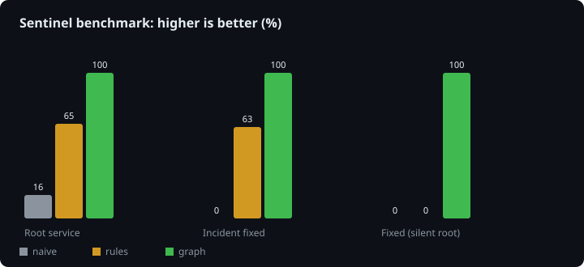
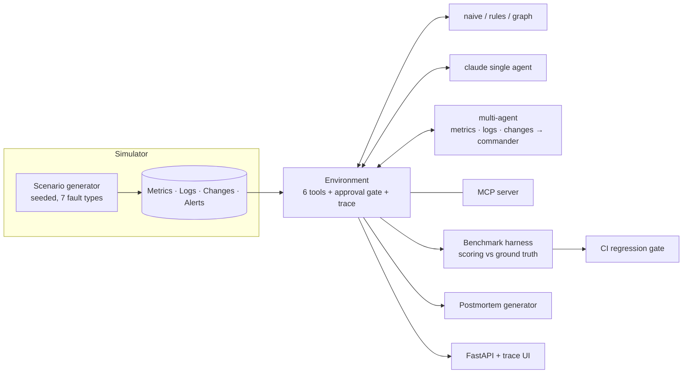

# Sentinel

**Autonomous incident-response agents, and the benchmark that scores them.**

Sentinel gets paged for a failing microservice stack, investigates through tools (metrics, logs, change history),
finds the root cause, and proposes a fix that has to pass a human-approval gate. It ships with a fault-injection
simulator so every agent can be scored against ground truth, not vibes.



## Why this exists

Most "AI agent" demos have no way to tell whether the agent is any good. Sentinel makes that measurable:

- **A simulator** generates seeded incidents: 7 fault types over a 7-service call graph, with decoy deploys,
  noisy logs, and **silent root causes** (about 35% of incidents): the broken service fires no alert and logs nothing.
- **Tools, not prompts.** Agents see the same 6-tool surface, as plain Python, as an Anthropic tool-use schema,
  and as an **MCP server**.
- **Safety is scored.** `run_remediation` is approval-gated; destructive actions on an unaffected service are refused
  and counted as unsafe actions.
- **Five agents, one harness**: from a naive alert-follower to a multi-agent Claude system.

## Results

100 seeded incidents (`make bench`, no API key needed):

| Agent | Root service | Fault type | Incident fixed | Fixed, silent root | Unsafe actions / incident | Tool calls |
|---|---|---|---|---|---|---|
| `naive`: follows the first alert | 16% | 15% | 0% | 0% | 0.84 | 2 |
| `rules`: expert system on alerts + logs | 65% | 70% | 63% | **0%** | 0.35 | 3 |
| `graph`: metric-anomaly + call-graph reasoning | 100% | 100% | 100% | 100% | 0.00 | 30 |

Read these honestly:

- `graph` is a **hand-engineered reference** written against this simulator, so treat it as a ceiling, not a
  general solution. Its job is to prove the benchmark is solvable and to show *what reasoning* the silent cases need.
- The `rules` agent's 0% on silent incidents is the point of the benchmark: alert-driven logic cannot find a root
  cause that never alerts.
- The `claude` (single agent) and `multi` (commander + 3 specialists) results are **not in this table yet**. They need
  an API key: `make bench-llm` regenerates the table and chart with them included.

## Architecture



See [docs/ARCHITECTURE.md](docs/ARCHITECTURE.md) for design decisions.

## Quickstart

```bash
make install                      # venv + editable install + dev tools
make test                         # 22 tests, no API key needed
python -m sentinel bench --n 100  # offline agents
python -m sentinel investigate --seed 7   # full investigation + postmortem
python -m sentinel serve          # UI at http://localhost:8000
python -m sentinel mcp --seed 7   # MCP server over stdio
```

With `ANTHROPIC_API_KEY` set, add `--agents naive rules graph claude multi` to `bench`, or pick `claude` / `multi` in the UI.

Use it from Claude Code or any MCP client:

```json
{ "mcpServers": { "sentinel": { "command": "python", "args": ["-m", "sentinel", "mcp", "--seed", "7"] } } }
```

## Project layout

```
sentinel/
  simulator/      fault-injection engine: topology, fault propagation, ground truth
  environment.py  the tool surface, approval gate, structured trace
  agents/         naive · rules · graph (offline) · llm (tool loop) · multi (commander + specialists)
  bench/          harness, scoring, SVG chart
  server/         FastAPI app, trace UI, MCP server
  postmortem.py   blameless postmortem from the tool trace
  cli.py          bench | investigate | serve | mcp
tests/            22 tests; LLM paths run against a scripted stub client
```

## Design notes

- **Least privilege in multi-agent mode.** Each specialist only receives the tools it needs; only the commander can
  call `run_remediation`, and it sees findings, not raw telemetry.
- **Human-in-the-loop as a first-class mechanism.** The approval gate judges "is this service affected" from real
  degradation, not alerts, so a silent root cause can still be fixed correctly.
- **Deterministic and reproducible.** Seeds fix everything, so a regression is a diff in a table.
- **CI gates quality.** The benchmark job fails the build if `graph` drops below 95% fixed, unsafe actions appear,
  or `rules` stops beating `naive`.

## Limitations and roadmap

- The simulator is synthetic. Next step: replay real incident data (e.g. public postmortems) as scenarios.
- One fault per incident. Concurrent and cascading faults are the obvious harder tier.
- Postmortems are template-based; an LLM-written narrative with citations to trace steps is planned.

MIT licensed.
